

  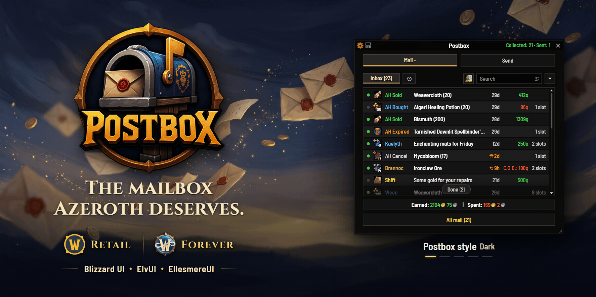

  <b>A modern, lightweight replacement for the World of Warcraft mailbox.</b> 
  Collect everything or just what sold, keep track of every character's mail and what's about to expire, send with names that finish themselves, and shape the window to fit your UI.

  <b>Runs on retail WoW (12.0.7–12.1.x) and, new in 1.60, fully supports World of Warcraft: Forever (1.60.1), from one download.</b> 
  On the Blizzard UI it wears its own Dark or Light style or the game's own look; under ElvUI or EllesmereUI it matches them. 
  No dependencies, no libraries &nbsp;·&nbsp;
  <a href="https://www.curseforge.com/wow/addons/postboxmail">CurseForge</a> &nbsp;·&nbsp;
  <a href="CHANGELOG.md">Changelog</a> &nbsp;·&nbsp;
  <a href="https://github.com/egsherlock/Postbox/issues">Report a bug</a>

## At a glance

| | |
|---|---|
| **Mail tab** | One-click collection in the order your list shows, search and row selection, optional buttons by kind and for your own character groups, finished mail out of the way under one quiet bar, and a History of what you collected. |
| **Arrange** | Drag, hide and set up every column and button right in the window; each list keeps its own layout. |
| **Mail Memory** | Every character's last-seen mailbox, from anywhere, searchable across characters, with warnings before mail is lost. |
| **Send tab** | Names complete as you type, a line says what a send will do, gold always asks first, and more than twelve items go out in one press. |
| **Minimap icon** | Optional: two dozen hand-painted styles, a count of what's waiting, and a marker for mail about to expire. |
| **Looks** | Follows EllesmereUI or ElvUI; on the game's own UI, wears the Postbox style (the default, in Dark or Light) or the Blizzard look. |
| **Options** | Five tabs, General first with every character's mail at a glance, and a panel that explains and previews whatever you point at. |
| **WoW Forever** | The same download: full names, Forever's mail rules, slow sends waited for, and Blizzard's mailbox for controller players. |

Found a bug, on retail or in WoW Forever? Please report it: open an
[issue](https://github.com/egsherlock/Postbox/issues) or leave a comment on
[CurseForge](https://www.curseforge.com/wow/addons/postboxmail). **Report a
bug**, at the foot of the options (or `/postbox debug`), gives you a report
to paste in, with no character names in it.

## World of Warcraft: Forever

Since 1.60 the same download runs in WoW Forever: CurseForge lists it under
WoW Forever, and WowUp offers it for a Forever install. By hand, copy the
`Postbox` folder into `World of Warcraft\_forever_\Interface\AddOns\`.
Forever keeps its own settings, separate from retail's.

- **Full names.** Write the whole name, "Abla Stone" or "Abla-Stone" (the
  same character either way). Postbox uses the full name everywhere, so two
  of your characters with the same first name never get mixed up.
- **Rulesets.** Mail can't cross rulesets, so Postbox files your characters
  by ruleset (Normal, PvP, RP and RP-PvP) and warns before mail to one it
  has seen on another. It knows a character once you've logged in on it
  with Postbox, and never adds a realm to a Forever address.
- **Sending.** The Send tab warns about a first name alone, never suggests
  the Warband bank, and promises instant delivery between your characters
  only when the game does. A slow server isn't called a failure: if you
  close the mailbox while it waits, Postbox tells you to check your mailbox
  before sending again.
- **Gold from strangers.** The game asks before you take gold from someone
  it doesn't know, and Postbox waits for your answer. You answer the game's
  question; Postbox never answers it for you.
- **Reload and controller.** After a style change, **Reload now** reloads;
  in combat it asks you to type `/reload`. With the Gamepad interface style
  you get Blizzard's own mailbox, and a style change made with the mailbox
  open applies the next time you open it.
- **Known limit.** Postbox is built for Forever 1.60.1, so a Forever patch
  can show it as "out of date" until Postbox is updated.

## The Mail tab

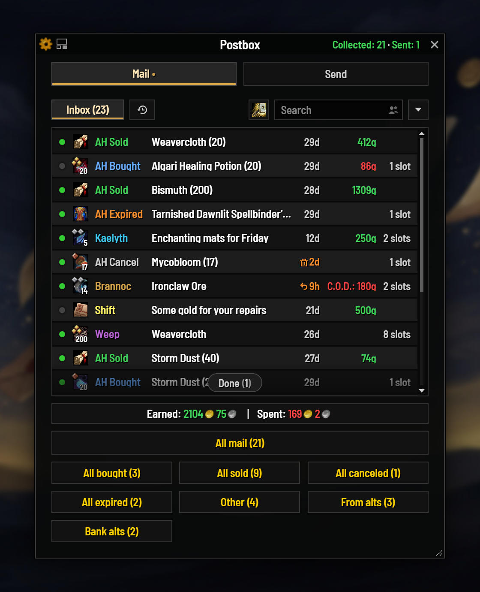

One inbox. Mail that still holds something comes first; read mail with nothing
left sits under a bar at the foot of the list: click it to fold it away, or
delete it all at once. While it is out of view the bar waits as a small
island over a soft shadow at the list's foot; scroll to it or click it and it
opens. How the bar looks (the **Island**, a thin **Hairline** or a **Full
row**), what it says (your own words too), its count, its icon and its colors
are yours to choose (**Bar look**, **Bar says**, **Count**, **Bar icon**,
**Bar color**, **Shadow color**). Read mail can go to a **Done** tab
instead, or be deleted the moment Postbox empties it (**Finished mail**,
**Where it goes**: **Delete when done**).

- **All mail** collects everything still holding something, one server
  command at a time, in the order the list shows. Under a search it collects
  what's shown; with rows selected (Shift-click a range, Ctrl-click one) it
  collects your picks. C.O.D. mail is never swept.
- **Sort by time left:** Newest first or Expiring first, remembered. When your
  bags fill, what's left is the bottom of the list.
- **Time left** turns amber under three days (one for C.O.D.). On a mail that
  still holds something, a curved arrow in front says it goes back to its
  sender, a bin that it is deleted (**Expiry marks** turns them off); the
  tooltip's **On expiry:** line says the same.
- **Largest stack first:** a mail holding several stacks of an item you can
  only carry so many of gives you the largest first.
- **Bags are checked before anything opens**, with an offer to collect what
  fits. **Keep bag slots free** (1 to 12) leaves room for loot; gold still
  comes out. If the bags fill anyway, the run stops and the title bar says
  how many mails are left. Nothing is collected behind your back.
- **Stuck** means one mail's own problem: a small triangle, the game's own
  words, and `Stuck: N` in the title bar, which filters the list to those
  mails. It clears itself once the mail can come out (for example once you
  hold fewer of a limited item). A slow reply just gets one more try.
- **Gold from strangers:** where the game asks before you take gold from
  someone it doesn't know (WoW Forever, and retail from patch 12.1.7), the
  run pauses on that mail until you answer: Accept and the gold comes,
  Cancel and it stays in the mail while the rest carries on.
- **C.O.D. prices are red,** as spent gold is, so amber only ever means time
  running out; the totals under the list add the C.O.D. still to pay.
- **Category buttons** (off by default; **Show category buttons**): All
  bought, All sold, All canceled, All expired, Other, From alts, and one for
  each **Character Group** you make: your bank alts, your crafters, a friend
  who sends you materials.
- **Rows:** compact by default, or **Larger mail rows** on two lines. **Row
  layout** is Columns (every figure under its heading) or Packed (each mail's
  figures together, the subject gets the rest). Columns: read mark, icon,
  sender, subject, time left ("9h", "3d"), gold, slots.
- **Item icons** carry stack counts and crafting quality marks, as your bags
  do. Hover an icon for what the mail holds, or set **Attachments on hover**
  to **Fan out** and click one item to take it (C.O.D. still asks first).
- **Senders wear their class color** when Postbox knows them (your alts,
  friends, guild), in your UI's own class colors.
- **One tooltip format everywhere:** the subject, then only what the row
  doesn't already show, and last what you can click, one gesture per line
  in smaller type.

 

  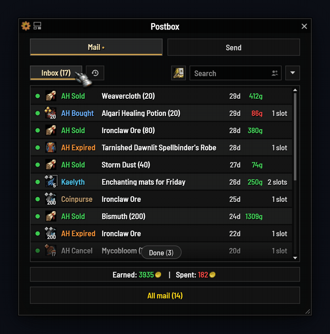

  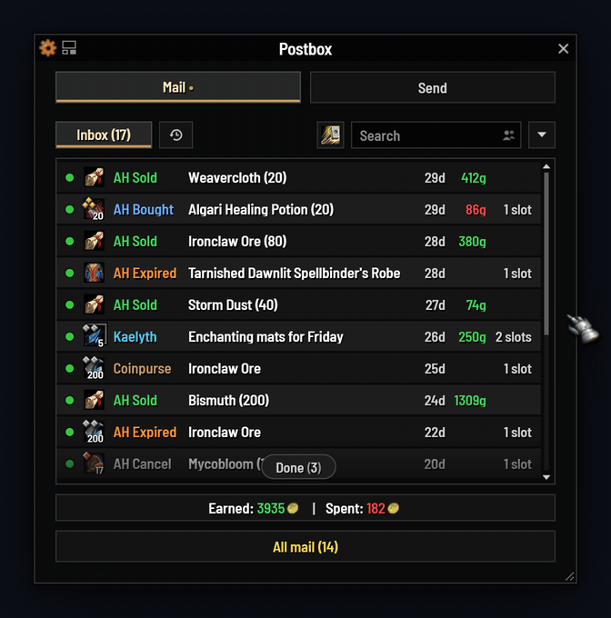

  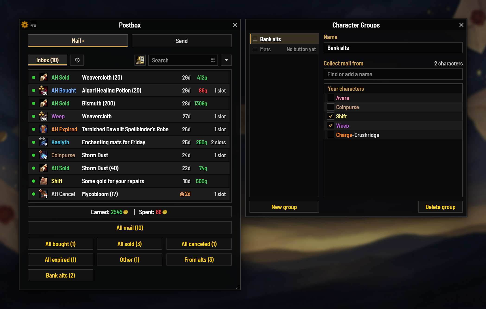

### History

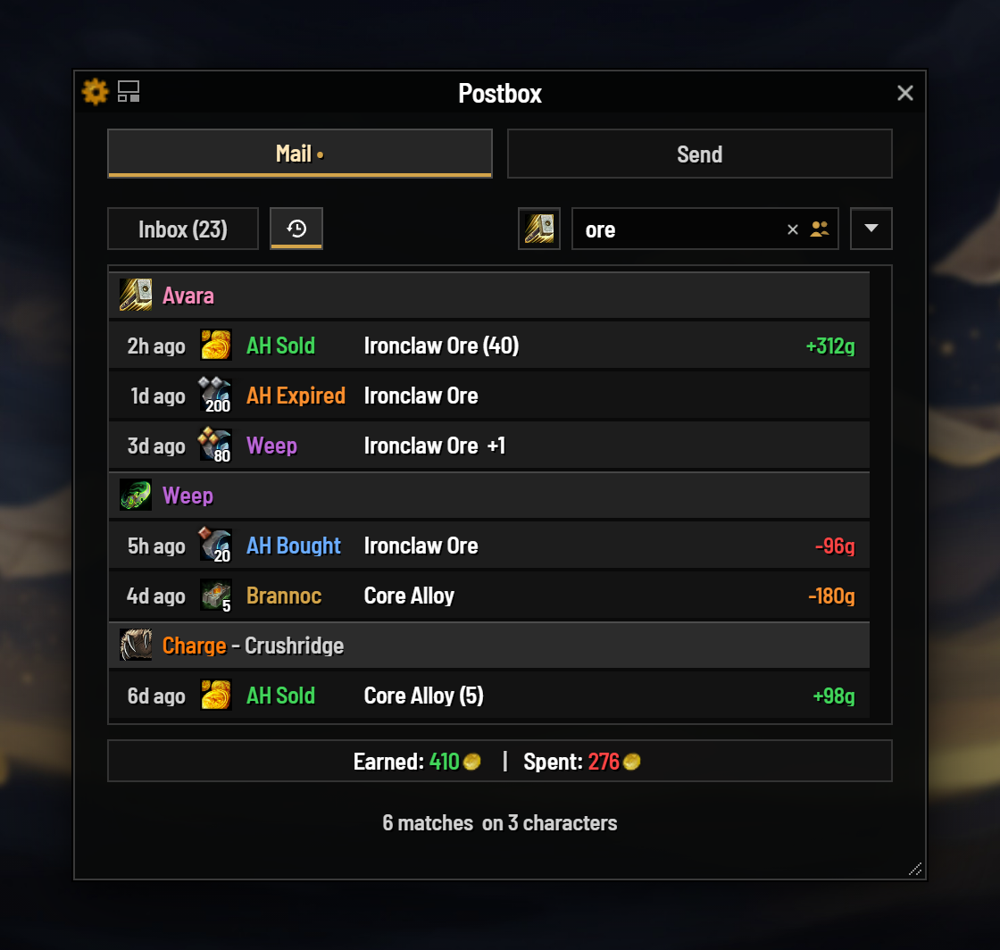

The clock beside Inbox lists what Postbox collected on this character, newest
first: when, from whom, what came out and what it was worth, with the
letter's text kept after the mail is gone. **Keep History for** 7, 14, 21 or
30 days, or **Never** (asks, then clears every character's). At most 1,000
entries per character. History has its own layout, shows when you collected
("3d ago" or the date, either way round), and **Search every character**
looks through all of them.

 

## Arrange it your way

  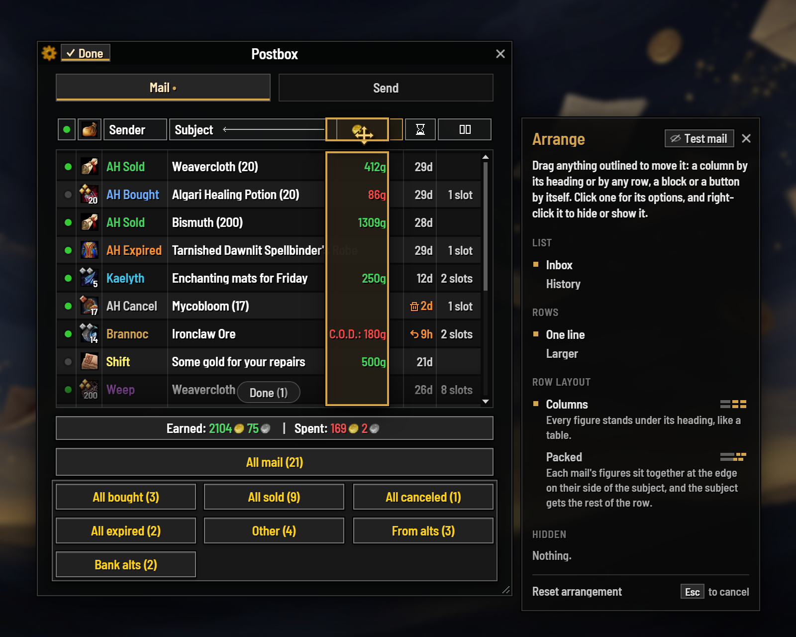

Click the arrange mark beside the options cog (Mail Memory's window has both
too):

- **A column header takes the top row's place**, each heading over its column.
  Drag a column by its heading or straight from any row; right-click to hide
  it, click it for its choices (what Gold, Time left and Slots show).
- **The blocks under the list lift off:** the totals, All mail and the
  category buttons. Drag them into your order, move or hide single buttons,
  or hide the totals and buttons altogether.
- **A panel docks beside the window** and explains whatever you select.
  Escape steps back one thing at a time; **Done** finishes, and **Reset
  arrangement** goes back to the default after asking.

One-line rows (shared with Mail Memory), Larger mail rows and History each
keep their own arrangement. **Test mail** fills the list with sample mail
while you arrange, or on its own from **Test**, beside **Arrange** in
Options, Mail tab, which is lit while it is on. The samples show what your
settings do: under **Delete when done** there is no read mail and no
bar, and resting on an item icon lists its items or fans them out, as
**Attachments on hover** is set, though nothing can be taken. **Arrange**
works away from a mailbox too, opening the window beside the options.

## Mail Memory

  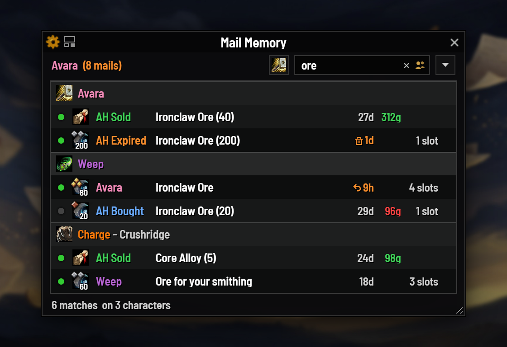

A snapshot of each character's mailbox, taken at every visit (up to 100
mails). Away from a mailbox it opens from the minimap icon, the addon
compartment or `/postbox mail`; at a mailbox, the **Characters** picker shows
any character's box right in the Mail tab (right-click it to come back to
your own). **Search every character** looks through all of them at once.
Every box says how long ago it was seen; it never pretends to be live. Hover
a mail to see what it holds. A character you no longer play can be hidden
(Options, General, **Hidden characters**).

- **Arrivals are detected, not guessed:** the game's new-mail signal, the
  unread flag, and the auction house's own sold / expired / bought notices.
- **Warnings** name any character with mail holding gold or items (or a
  C.O.D.) under three days (one for C.O.D.) from expiring, or with mail
  known to be on its way and no mailbox visit in over three weeks, the
  character you're on included. One choice, **Warn about** (Options,
  General, Expiring mail), sets what both warnings cover: **Mail to be
  deleted**, **Mail to be deleted or sent back**, or **Off** (mail last seen
  before 1.60 counts as possibly deleted, to be safe). They come as a
  line in chat at login (**Chat line at login**) and as the minimap icon's
  marker (**Minimap marker**: with the icon, always, or off); the minimap
  tooltip names them too.
- **Mail waiting in your mailboxes,** a card across the top of the options'
  General tab, lists each character's box as it was last seen (mail, gold,
  the soonest to expire with its arrow or bin, and how long ago), with a
  total for all of them. Mail about to go back or be deleted comes first,
  even on an alt you haven't played in months, then the characters you
  played most recently. Past five lines the list scrolls inside the card;
  past twenty characters it ends in "+N more in Mail Memory". Click a
  character to open its box in Mail Memory. Beside the list, Mail Memory,
  Character Groups and Manage Recipients are a click away.

## Sending

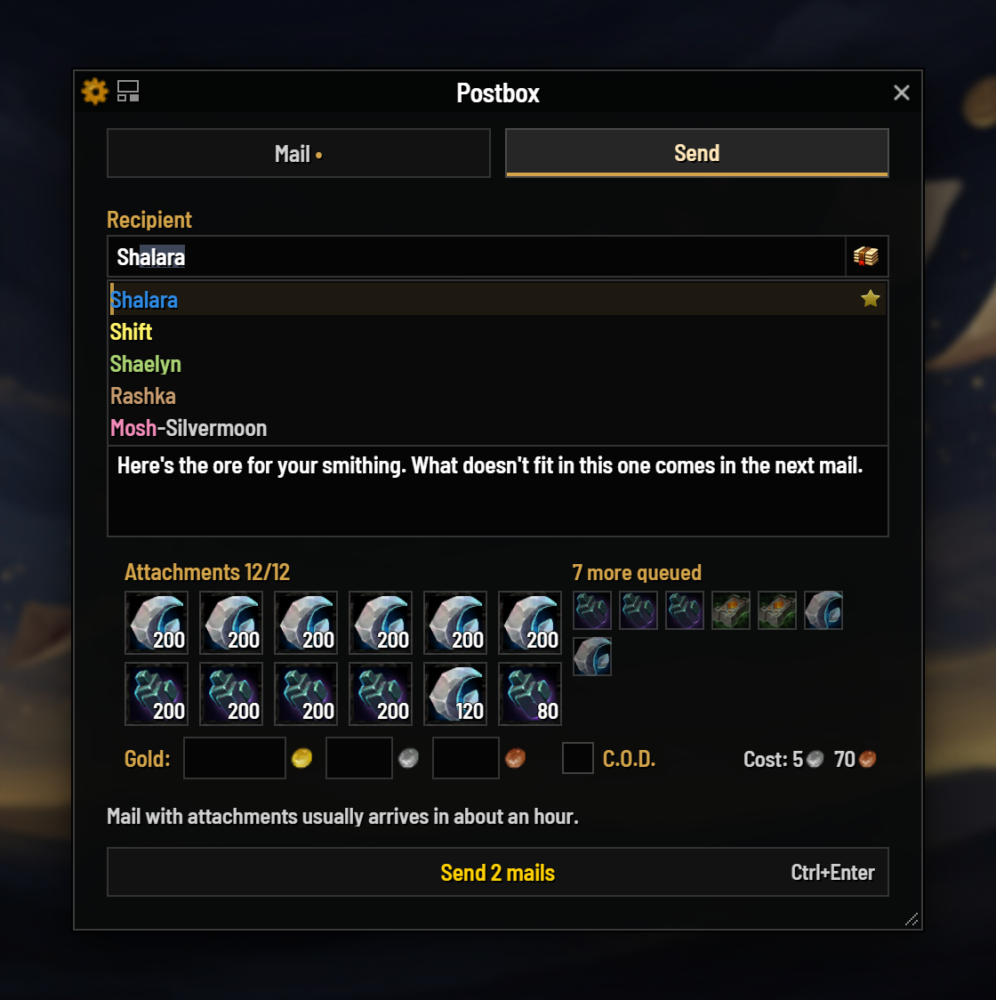

- **Names complete in place** from your favorites, recent contacts, alts,
  guild and friends (Battle.net included). Tab and Shift+Tab walk the
  suggestions, Enter takes the whole name, and the realm is added only when
  it's another realm.
- **A guidance line** says whether the mail arrives instantly or in about an
  hour, and whether a cross-realm send can carry what's attached. It advises;
  it never blocks.
- **Past twelve items**, right-clicks keep queuing; one press sends the rest
  as further mails to the same person, after one confirmation. Alt+right-click
  attaches every stack of an item; right-click "Attachments" clears them all.
- **Gold asks first**, and asks again if the name, the amount, C.O.D. or the
  number of mails changes before you answer.
- **Ctrl+Enter sends** from any box (a setting, on by default; the Send button
  shows the keys). **After sending, keep** nothing, the recipient, or the
  recipient and subject.
- Shift-click an attached item to link it, Ctrl-click to try it on.
- Unmailable items in your bags are grayed with a padlock while you compose,
  in the default bags, Baganator and EllesmereUI bags.

**Manage Recipients** (`/postbox rm`, works anywhere) searches, sorts,
favorites, hides and annotates every name Postbox can suggest.

  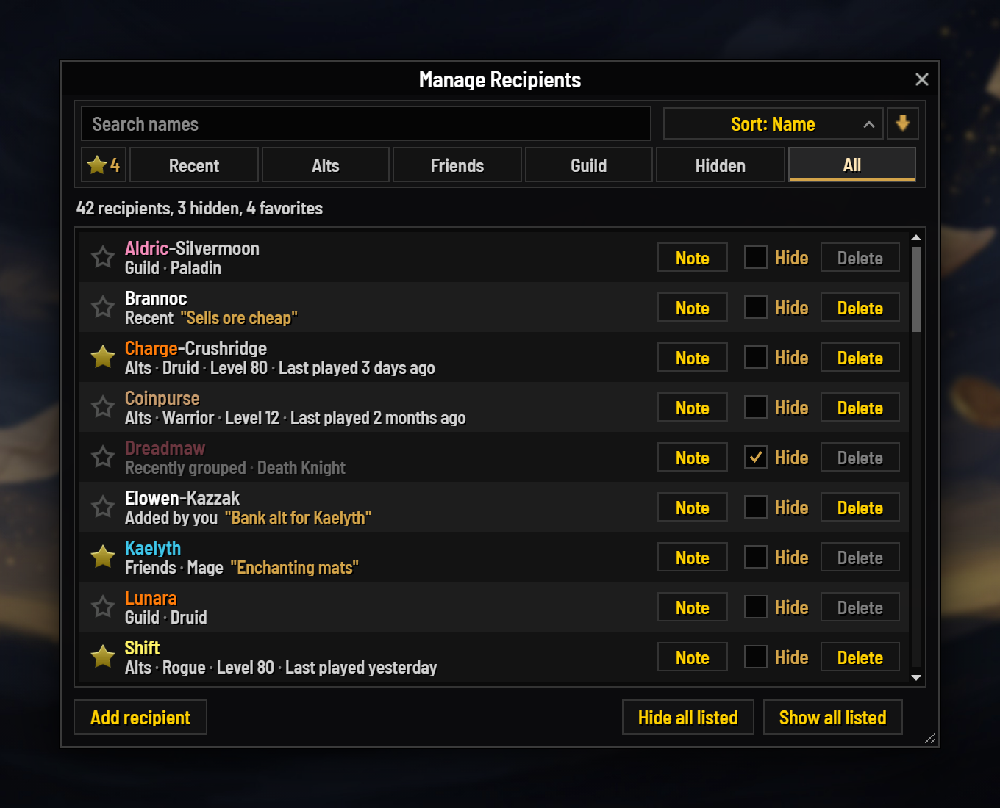

 

## The minimap icon

  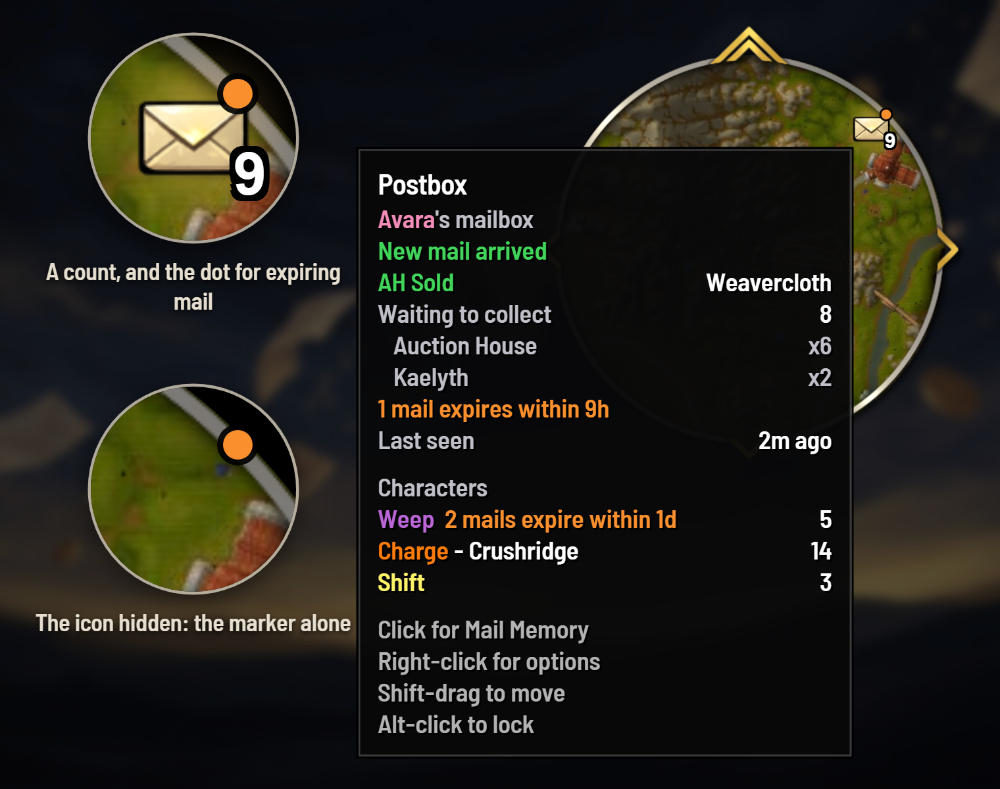

Optional, and off until you turn it on; while it's on, the game's own mail
icon steps aside.

- **When to show:** New mail, Mail on any character, or Always (resting in
  gray until something arrives).
- **Expiring mail:** a small marker, red unless you pick another color, when
  mail on any character is about to be deleted or sent back (switched on,
  and told which, under General: **Minimap marker** and **Warn about**).
  Choose its shape (dot, ring,
  square, bar, "!" or a triangle that fits its spot), put it on any corner,
  side or the center of the icon, and nudge it a pixel at a time with
  **Offset X** and **Offset Y**. On **Always** it stays on the map while the
  icon is hidden, the same size and in the same place; **Larger when alone**
  makes it bigger there.
- **Count on icon** (this character or all), shadow, glow and pulse, with a
  **Glow color** of gold, your accent, your class color, white or any color
  you pick. **Flash on new mail** (Options, General, New mail) swells a
  halo in that color when mail arrives.
- **The Minimap tab** reads in five groups (When it shows, Icon, Glow,
  Expiring mail, Place). Its preview draws the icon large beside a copy at
  its real size, wearing every setting; settings with choices show them
  side by side, and a grayed-out setting says what turns it on. What needs
  Mail Memory (Mail on any character, Count on icon, the marker) is grayed
  out while it is off, and the marker's look also while Warn about is Off.
- Two dozen hand-painted styles from 16 to 40 px, on the minimap's rim or
  anywhere on screen (Shift-drag; Alt-click locks it).
- **Its tooltip** shows your own mailbox first, then each of your other
  characters with mail. Click for Mail Memory, right-click for the options.
- Under EllesmereUI's minimap it restyles *their* mail button in place, and
  EllesmereUI keeps its size, place and its own Hide Mail setting.

## Options and looks

  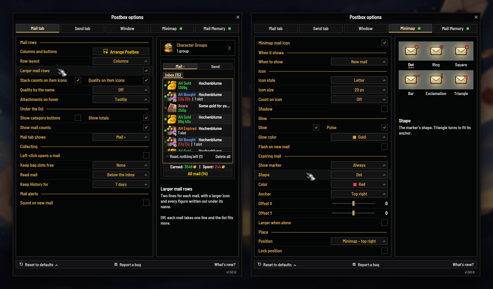

Five tabs (General, Mail tab, Send tab, Window, Minimap), one column of
settings, and a panel beside it that explains whatever you point at and shows
it. **General** comes first: every character's mail at a glance on a card
across the top, with **Mail Memory**, **Character Groups** and **Manage
Recipients** beside it; under it Mail Memory's settings, **Expiring mail**
(Warn about, Chat line at login, Minimap marker) and **New mail**: **Sound
on new mail** (one of four soft sounds made for Postbox, the mail chime or
another quiet sound of the game's, or any sound your other addons share
through LibSharedMedia, such as ElvUI's or WeakAuras', with a button to hear
it first; it stays quiet for your own auction house purchases, which the
game already announces) and **Flash on new mail**. The options open beside
whatever opened them: right of the Postbox
window from its cog, below Mail Memory from its cog (on General), left of the minimap
from the icon. With **Dock beside game windows** on they stay beside that
window as it moves or resizes, so you can watch a setting reshape it; drag
them and they stay where you put them. **Reset to defaults** opens a menu below it: **Reset this tab**, **Reset
settings** (your recipients, groups, Mail Memory and History are kept) or
**Reset everything**, each saying what it clears before it asks. **What's
new?** in the footer shows the last three releases.

  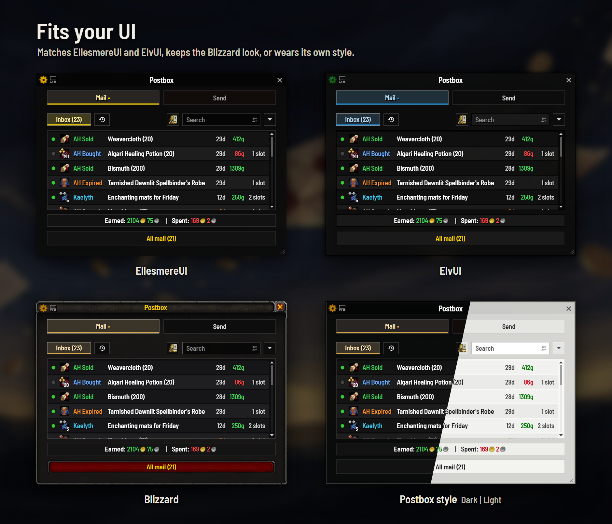

- **EllesmereUI:** its font for all of Postbox's text, its accent, and **Match
  EllesmereUI** opacity and border (the default), so Postbox matches the
  windows beside it, atrocityEssentials' included. Under EllesmereUI's
  Blizzard Style or Classic WoW UI, Postbox wears its Blizzard look to match.
- **ElvUI:** its accent (value color) and class colors, live.
- **The Postbox style** (the default on the game's own UI): **Dark** or
  **Light** mode, accent (Gold by default, White and other presets, your
  class color or any color), background color, opacity, border (None, Edge,
  Thin or Thick) and its color, corners, row stripes, sheen, font and text
  size. In Light mode text is crisp dark ink and your accent stays in the
  marks; each mode keeps its own background.
- **Blizzard**, to match the default UI with the game's own art (texture
  packs restyle it).
- **Window scale** from 80% to 130% in every look.

  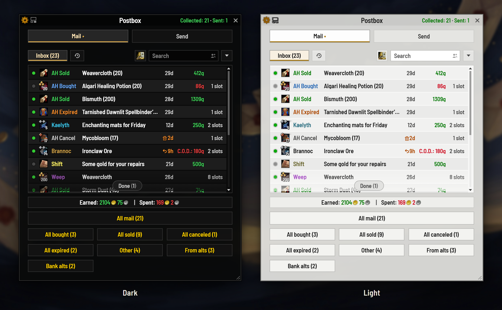

## How it's built

- **No libraries.** `Lib/` is a small hand-rolled foundation: saved-variable
  store, event bus, string and money formatting, an inventory-lock overlay and
  a few UI primitives. No Ace, no LibStub.
- **It never replaces Blizzard's mail code.** Postbox draws its own window and
  calls the mail API directly; its arranging is its own, never Blizzard's Edit
  Mode. The one known combat case is documented in
  [COMBAT_TAINT.md](COMBAT_TAINT.md).
- **Idle means idle.** Nothing runs on a repeating timer away from a
  mailbox, and per-frame work runs only while you drag, resize or arrange
  something, stopping when you let go.
- **Measured, not assumed.** A 50-mail list refresh leaves under 2 KB of
  garbage (35 KB in 1.40), a collect run about a third of what it did, and a
  Mail/Send switch redraws your bags once instead of three times.
  `/postbox perf` records each mailbox visit for a bug report, with the game's
  own profiler split into Postbox, other addons and the game.
- **Safe by design.** One C.O.D. confirmation pays once, for the mail you
  chose; deleting in bulk only ever removes finished mail you chose, a mail
  that still holds something asks before it goes, and every delete is
  re-checked right before it happens; every take follows its mail as the
  inbox moves.
- **One skin contract.** A look claims the window at login and answers
  `Apply`/`Refresh`; see [ELLESMEREUI_SKINNING.md](ELLESMEREUI_SKINNING.md).

## Languages

English, Français, Deutsch, Español, Русский, 简体中文 and 繁體中文, complete
rather than partial, with plural rules per language (Russian's one/few/many
included). The Chinese translations began with **samuelbears**, and every
string since is kept complete. Corrections and new languages are welcome:
strings live in `Core/Locales.lua`.

## Install and commands

From CurseForge or any addon manager, or copy the `Postbox` folder into
`World of Warcraft\_retail_\Interface\AddOns\` (for WoW Forever,
`World of Warcraft\_forever_\Interface\AddOns\`). One download serves both
games. Settings are account-wide, and each game keeps its own. What changes
in WoW Forever is under [World of Warcraft: Forever](#world-of-warcraft-forever).

| Command | |
|---|---|
| `/postbox` or `/pb` | The options |
| `/postbox help` | The list of commands |
| `/postbox mail` | Mail Memory: every character's mailbox |
| `/postbox rm` | Manage Recipients |
| `/postbox minimap` | Turn the minimap icon on or off |
| `/postbox whatsnew` | What's new in the last three releases |
| `/postbox perf` | Performance recording: off, on or detailed |
| `/postbox debug` | Report a bug: a copyable report (no character names, no full addon list) |

Licensed under [GPL v3](LICENSE).
