

  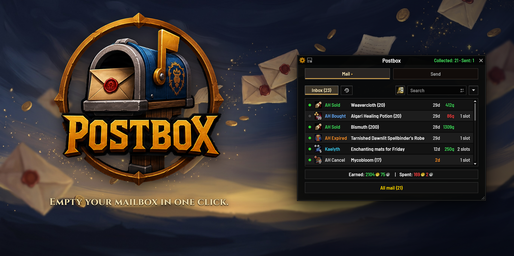

  <b>A modern, lightweight replacement for the World of Warcraft mailbox.</b> 
  Clear a full inbox in one click, arrange the window your way, see every character's mail from anywhere, and send without second-guessing.

  Retail 12.0.7–12.1.x &nbsp;·&nbsp; no dependencies, no libraries &nbsp;·&nbsp;
  <a href="https://www.curseforge.com/wow/addons/postboxmail">CurseForge</a> &nbsp;·&nbsp;
  <a href="CHANGELOG.md">Changelog</a>

## At a glance

| | |
|---|---|
| **Mail tab** | One-click collection in the order your list shows, search and row selection, optional buttons by kind and for your own character groups, read mail folded away, and a History of what you collected. |
| **Arrange** | Drag, hide and set up every column and button right in the window; each list keeps its own layout. |
| **Mail Memory** | Every character's last-seen mailbox, from anywhere, searchable across characters, with warnings before mail is lost. |
| **Send tab** | Names complete as you type, a line says what a send will do, gold always asks first, and more than twelve items go out in one press. |
| **Minimap icon** | Optional: two dozen hand-painted styles, a count of what's waiting, and a marker for mail about to expire. |
| **Looks** | Follows EllesmereUI or ElvUI, or wears the Postbox style (Dark or Light) or the Blizzard look. |
| **Options** | Five tabs, and a panel that explains and previews whatever you point at. |

## The Mail tab

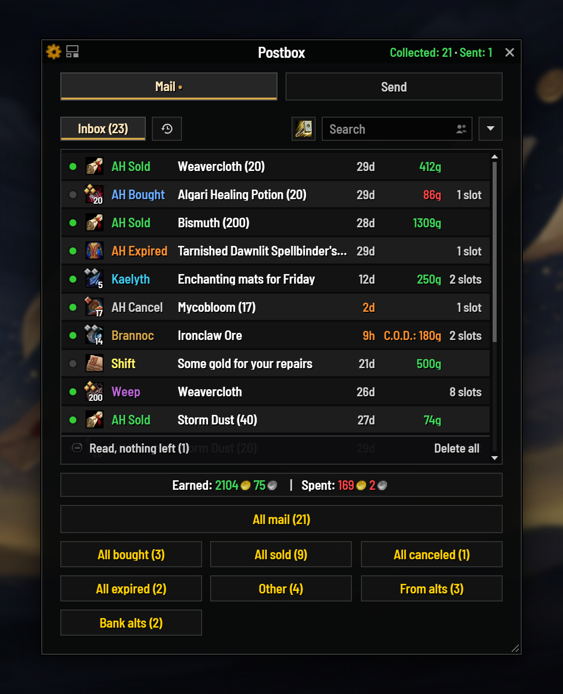

One inbox. Mail that still holds something comes first; read mail with nothing
left sits under a divider at the foot of the list: click it to fold it away,
or delete it all at once. Read mail can go to a **Done** tab instead, or be
deleted the moment Postbox empties it (**Delete when done**).

- **All mail** collects everything still holding something, one server
  command at a time, in the order the list shows. Under a search it collects
  what's shown; with rows selected (Shift-click a range, Ctrl-click one) it
  collects your picks. C.O.D. mail is never swept.
- **Sort by time left:** Newest first or Expiring first, remembered. When your
  bags fill, what's left is the bottom of the list.
- **Largest stack first:** a mail holding several stacks of an item you can
  only carry so many of gives you the largest first.
- **Bags are checked before anything opens**, with an offer to collect what
  fits. **Keep bag slots free** (1 to 12) leaves room for loot; gold still
  comes out. If the bags fill anyway, the run stops and the title bar says
  how many mails are left. Nothing is collected behind your back.
- **Stuck** means one mail's own problem: a small triangle, the game's own
  words, and `Stuck: N` in the title bar, which filters the list to those
  mails. It clears itself once the mail can come out (for example once you
  hold fewer of a limited item). A slow reply just gets one more try.
- **Category buttons** (off by default; **Show category buttons**): All
  bought, All sold, All canceled, All expired, Other, From alts, and one for
  each **Character Group** you make: your bank alts, your crafters, a friend
  who sends you materials.
- **Rows:** compact by default, or **Larger mail rows** on two lines. **Row
  layout** is Columns (every figure under its heading) or Packed (each mail's
  figures together, the subject gets the rest). Columns: read mark, icon,
  sender, subject, time left ("9h", "3d"), gold, slots.
- **Item icons** carry stack counts and crafting quality marks, as your bags
  do. Hover an icon for what the mail holds, or set **Attachments on hover**
  to **Fan out** and click one item to take it (C.O.D. still asks first).
- **Senders wear their class color** when Postbox knows them (your alts,
  friends, guild), in your UI's own class colors.
- **One tooltip format everywhere:** the subject, then only what the row
  doesn't already show.

 

  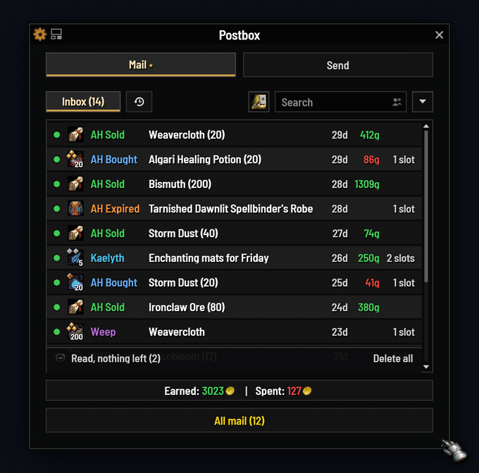

### History

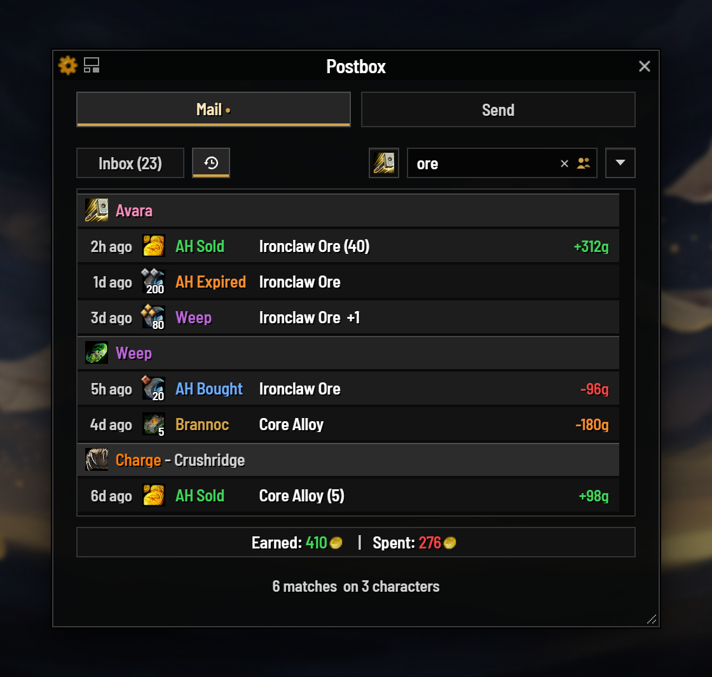

The clock beside Inbox lists what Postbox collected on this character, newest
first: when, from whom, what came out and what it was worth, with the
letter's text kept after the mail is gone. **Keep History for** 7, 14, 21 or
30 days, or **Never** (asks, then clears every character's). At most 1,000
entries per character. History has its own layout, shows when you collected
("3d ago" or the date, either way round), and **Search every character**
looks through all of them.

 

## Arrange it your way

  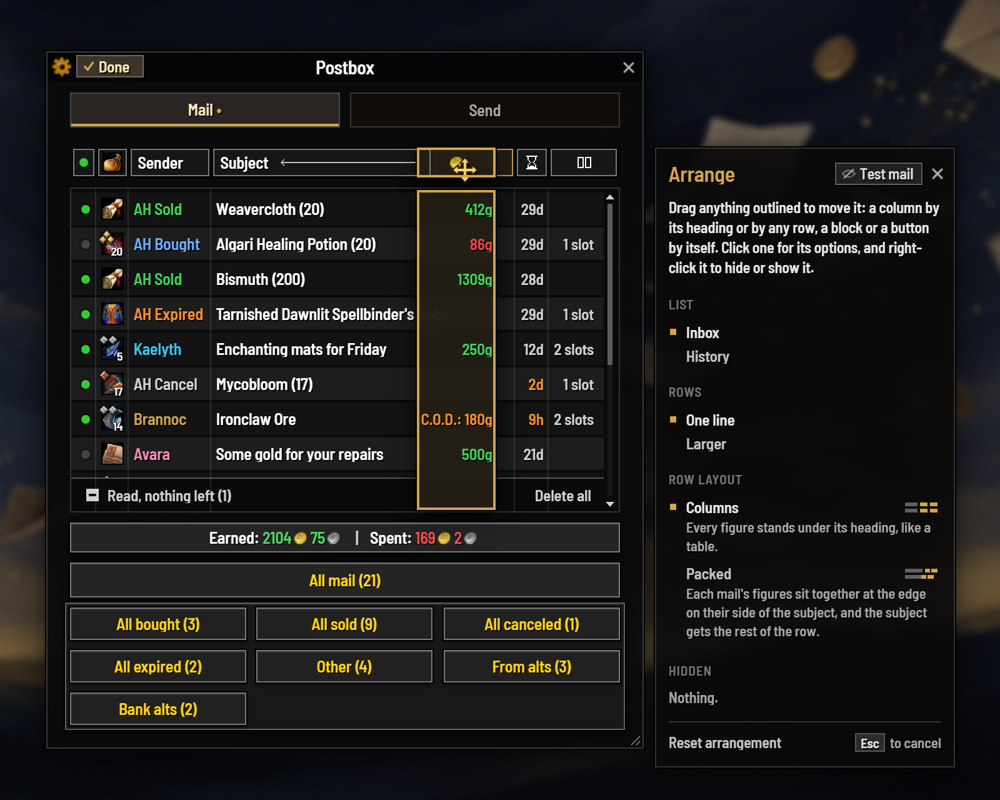

Click the arrange mark beside the options cog (in Mail Memory's window it sits
at the left of the title bar):

- **A column header takes the top row's place**, each heading over its column.
  Drag a column by its heading or straight from any row; right-click to hide
  it, click it for its choices (what Gold, Time left and Slots show).
- **The blocks under the list lift off:** the totals, All mail and the
  category buttons. Drag them into your order, move or hide single buttons,
  or hide the totals and buttons altogether.
- **A panel docks beside the window** and explains whatever you select.
  Escape steps back one thing at a time; **Done** finishes, and **Reset
  arrangement** goes back to the default after asking.

One-line rows (shared with Mail Memory), Larger mail rows and History each
keep their own arrangement. **Test mail** fills the list with sample mail
while you arrange, and **Arrange Postbox** in the options works away from a
mailbox too.

## Mail Memory

  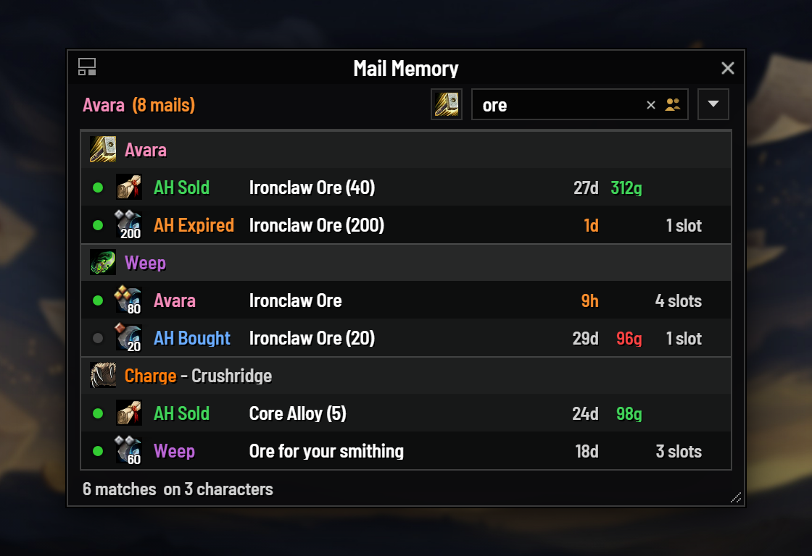

A snapshot of each character's mailbox, taken at every visit (up to 100
mails). Away from a mailbox it opens from the minimap icon, the addon
compartment or `/postbox mail`; at a mailbox, the **Characters** picker shows
any character's box right in the Mail tab (right-click it to come back to
your own). **Search every character** looks through all of them at once.
Every box says how long ago it was seen; it never pretends to be live. Hover
a mail to see what it holds. A character you no longer play can be hidden
(Options, Mail Memory, **Hidden characters**).

- **Arrivals are detected, not guessed:** the game's new-mail signal, the
  unread flag, and the auction house's own sold / expired / bought notices.
- **Warnings** name any character with mail under three days from expiring,
  or with mail known to be on its way and no mailbox visit in over three
  weeks: in chat at login (**Warn about other characters' mail**), in the
  minimap tooltip, and as the minimap icon's expiry marker.

## Sending

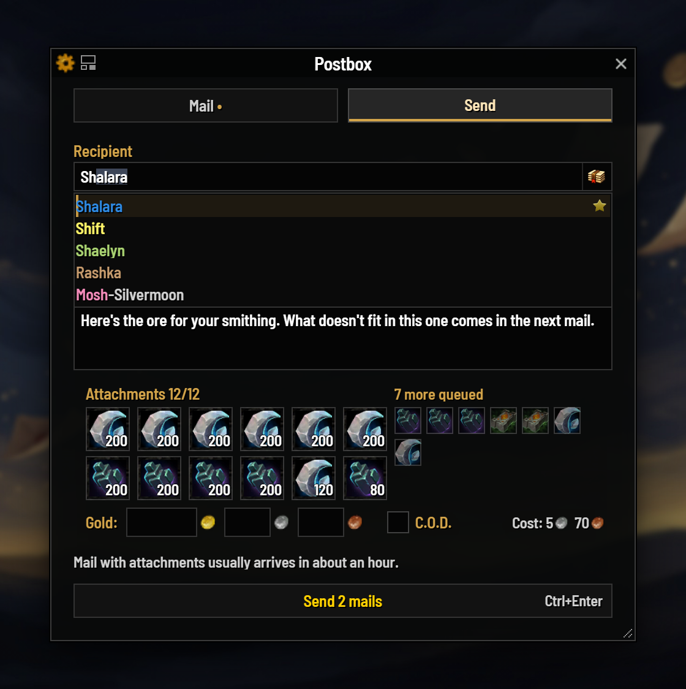

- **Names complete in place** from your favorites, recent contacts, alts,
  guild and friends (Battle.net included). Tab and Shift+Tab walk the
  suggestions, Enter takes the whole name, and the realm is added only when
  it's another realm.
- **A guidance line** says whether the mail arrives instantly or in about an
  hour, and whether a cross-realm send can carry what's attached. It advises;
  it never blocks.
- **Past twelve items**, right-clicks keep queuing; one press sends the rest
  as further mails to the same person, after one confirmation. Alt+right-click
  attaches every stack of an item; right-click "Attachments" clears them all.
- **Gold asks first**, and asks again if the name, the amount, C.O.D. or the
  number of mails changes before you answer.
- **Ctrl+Enter sends** from any box (a setting, on by default; the Send button
  shows the keys). **After sending, keep** nothing, the recipient, or the
  recipient and subject.
- Shift-click an attached item to link it, Ctrl-click to try it on.
- Unmailable items in your bags are grayed with a padlock while you compose,
  in the default bags, Baganator and EllesmereUI bags.

**Manage Recipients** (`/postbox rm`, works anywhere) searches, sorts,
favorites, hides and annotates every name Postbox can suggest.

 

## The minimap icon

  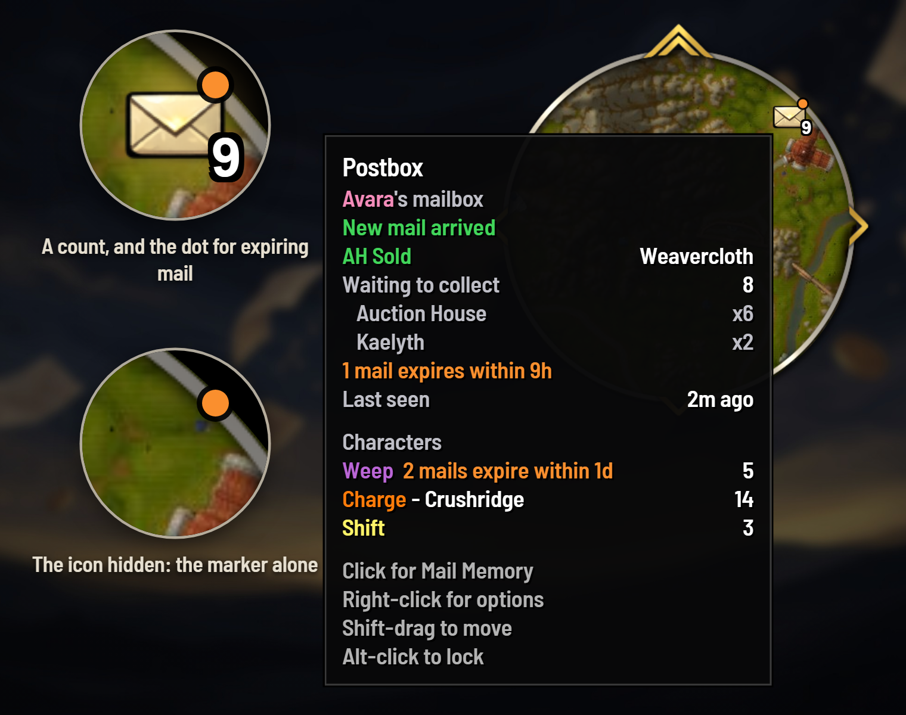

Optional, and off until you turn it on; while it's on, the game's own mail
icon steps aside.

- **When to show:** New mail, Mail on any character, or Always (resting in
  gray until something arrives).
- **Expiring mail:** a small marker (dot, ring, square, bar or "!") on the
  corner you choose when mail on any character is close to being lost. On
  **Always** it stays on the map when this character has no mail, the same
  size and in the same place; **Larger when alone** makes it bigger there.
- **Count on icon** (this character or all), shadow, glow, pulse and
  **Flash on new mail**, with a **Glow color** of gold, your accent, white
  or any color you pick.
- **The Minimap tab** reads in five groups (When it shows, Icon, Glow,
  Expiring mail, Place). Its preview draws the icon large beside a copy at
  its real size, wearing every setting; settings with choices show them
  side by side, and a grayed-out setting says what turns it on.
- Two dozen hand-painted styles from 16 to 40 px, on the minimap's rim or
  anywhere on screen (Shift-drag; Alt-click locks it).
- **Its tooltip** shows your own mailbox first, then each of your other
  characters with mail. Click for Mail Memory, right-click for the options.
- Under EllesmereUI's minimap it restyles *their* mail button in place, and
  EllesmereUI keeps its size, place and its own Hide Mail setting.

## Options and looks

  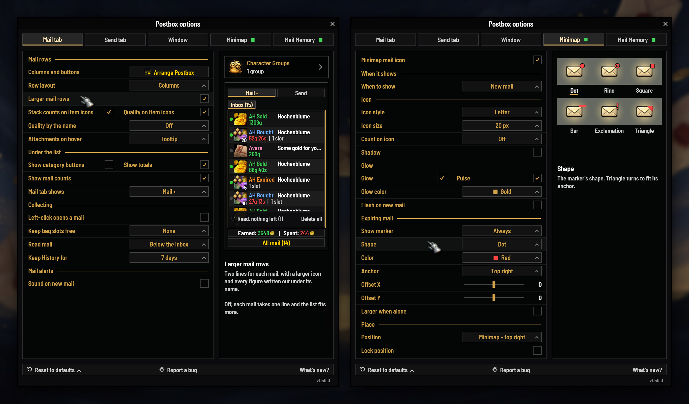

Five tabs (Mail tab, Send tab, Window, Minimap, Mail Memory), one column of
settings, and a panel beside it that explains whatever you point at and shows
it. **Reset to defaults** opens a menu: **Reset this tab**, **Reset
settings** (your recipients, groups, Mail Memory and History are kept) or
**Reset everything**, each saying what it clears before it asks. **What's
new?** in the footer shows the last three releases.

  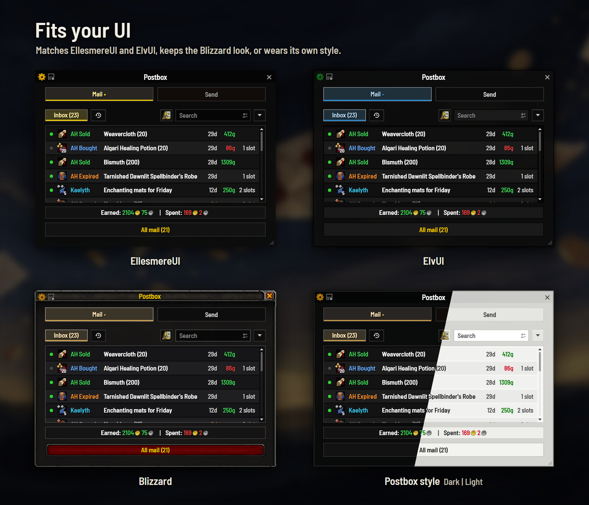

- **EllesmereUI:** its font for all of Postbox's text, its accent, and **Match
  EllesmereUI** opacity and border (the default), so Postbox matches the
  windows beside it, atrocityEssentials' included. Under EllesmereUI's
  Blizzard Style or Classic WoW UI, Postbox wears its Blizzard look to match.
- **ElvUI:** its accent (value color) and class colors, live.
- **The Postbox style** (the default on the game's own UI): **Dark** or
  **Light** mode, accent (White by default, presets, your class color or any
  color), background color, opacity, border (None, Edge, Thin or Thick) and
  its color, corners, row stripes, sheen, font and text size. In Light mode
  text is crisp dark ink and your accent stays in the marks; each mode keeps
  its own background.
- **Blizzard**, to match the default UI with the game's own art (texture
  packs restyle it).
- **Window scale** from 80% to 130% in every look.

  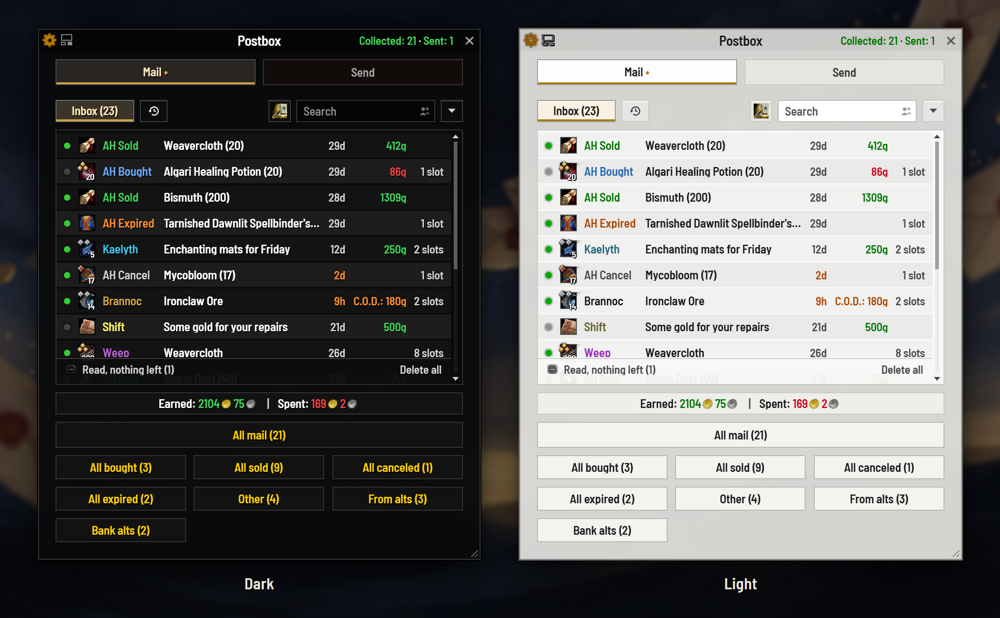

## How it's built

- **No libraries.** `Lib/` is a small hand-rolled foundation: saved-variable
  store, event bus, string and money formatting, an inventory-lock overlay and
  a few UI primitives. No Ace, no LibStub.
- **It never replaces Blizzard's mail code.** Postbox draws its own window and
  calls the mail API directly; its arranging is its own, never Blizzard's Edit
  Mode. The one known combat case is documented in
  [COMBAT_TAINT.md](COMBAT_TAINT.md).
- **Idle means idle.** Away from a mailbox nothing runs on a repeating timer
  or every frame; at one, per-frame work belongs to what you are doing and
  stops when it ends.
- **Measured, not assumed.** A 50-mail list refresh leaves under 2 KB of
  garbage (35 KB in 1.40), a collect run about a third of what it did, and a
  Mail/Send switch redraws your bags once instead of three times.
  `/postbox perf` records each mailbox visit for a bug report, with the game's
  own profiler split into Postbox, other addons and the game.
- **Safe by design.** One C.O.D. confirmation pays once, for the mail you
  chose; deletes only ever remove finished mail you chose and are re-checked
  right before they happen; every take follows its mail as the inbox moves.
- **One skin contract.** A look claims the window at login and answers
  `Apply`/`Refresh`; see [ELLESMEREUI_SKINNING.md](ELLESMEREUI_SKINNING.md).

## Languages

English, Français, Deutsch, Español, Русский, 简体中文 and 繁體中文, complete
rather than partial, with plural rules per language (Russian's one/few/many
included). The Chinese translations began with **samuelbears**, and every
string since is kept complete. Corrections and new languages are welcome:
strings live in `Core/Locales.lua`.

## Install and commands

From CurseForge or any addon manager, or copy the `Postbox` folder into
`World of Warcraft\_retail_\Interface\AddOns\`. Settings are account-wide.

| Command | |
|---|---|
| `/postbox` or `/pb` | The options |
| `/postbox help` | The list of commands |
| `/postbox mail` | Mail Memory: every character's mailbox |
| `/postbox rm` | Manage Recipients |
| `/postbox minimap` | Turn the minimap icon on or off |
| `/postbox whatsnew` | What's new in the last three releases |
| `/postbox perf` | Performance recording: off, on or detailed |
| `/postbox debug` | Report a bug: a copyable report (no character names, no full addon list) |

Licensed under [GPL v3](LICENSE).
