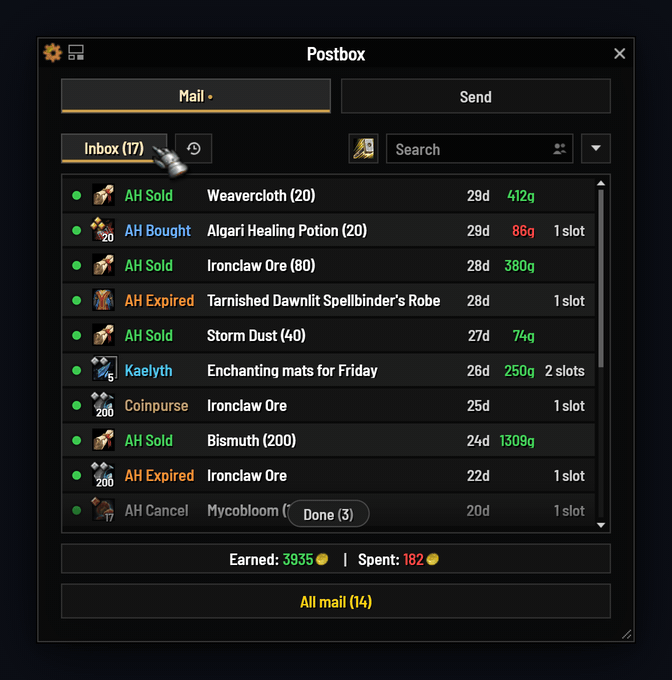
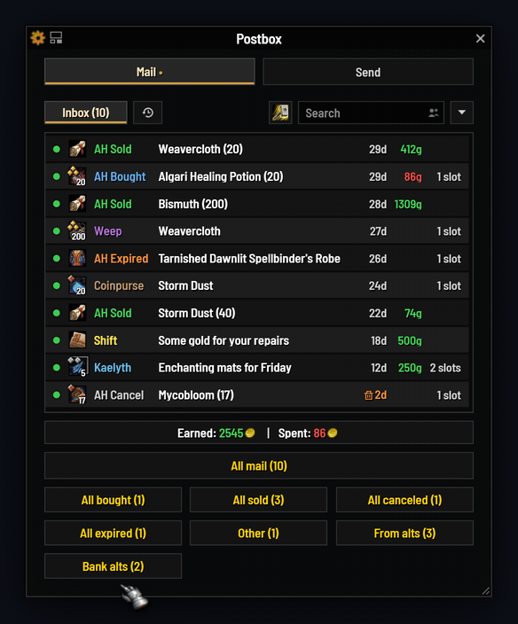
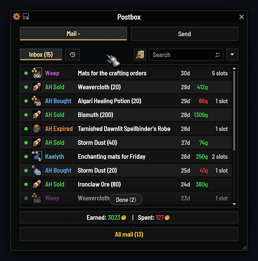
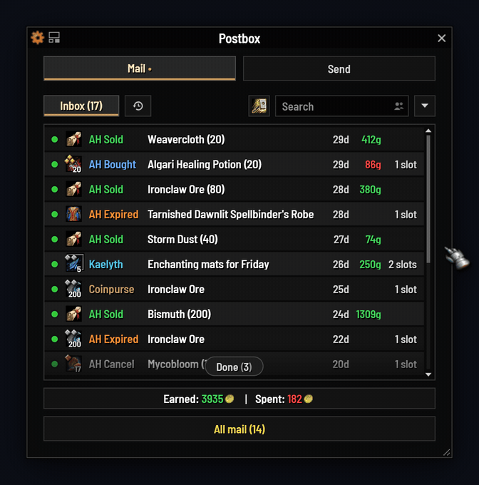
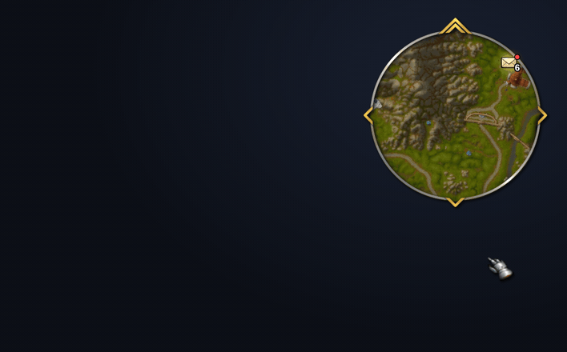
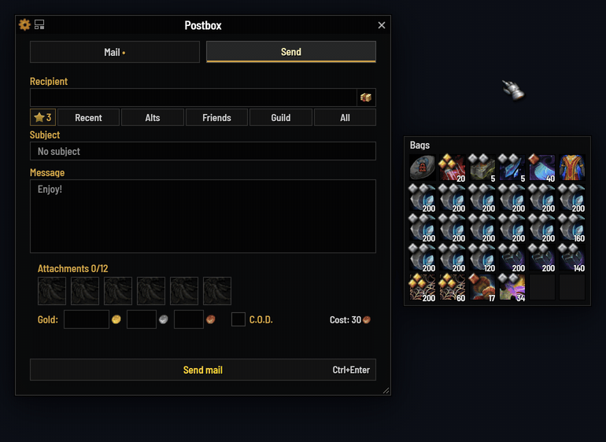
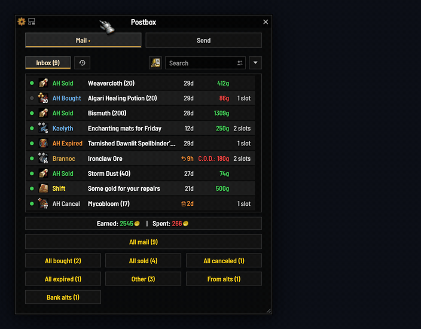
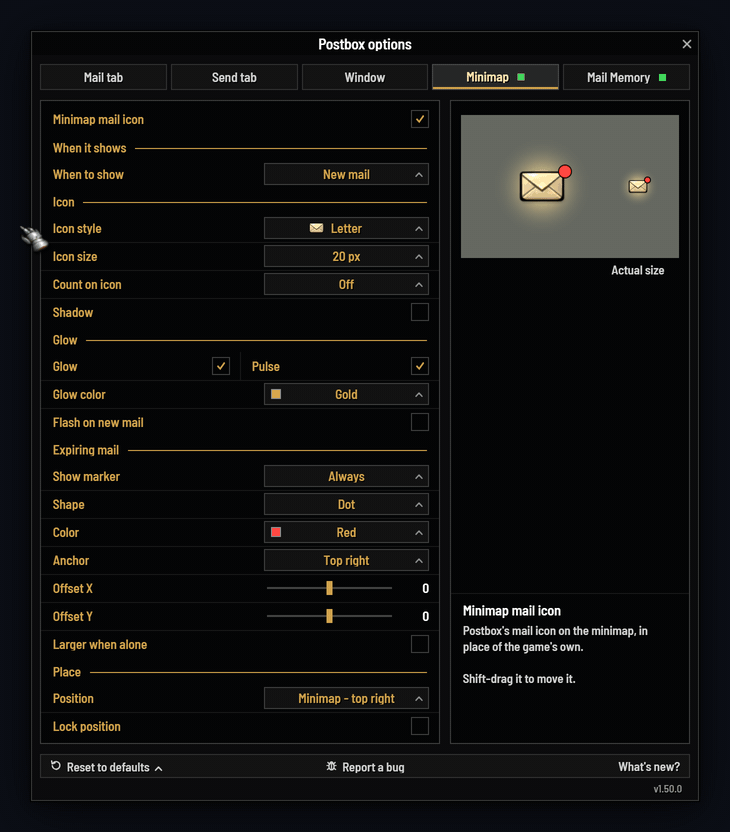
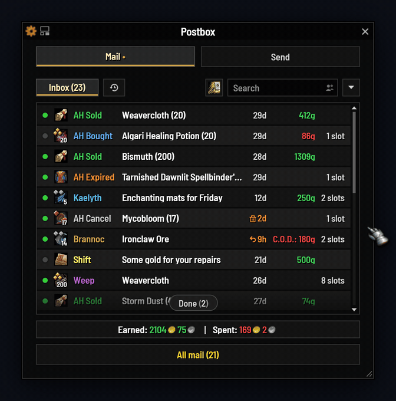

<h1 style="text-align:center">The mailbox Azeroth deserves.</h1>

<strong>Postbox replaces the game's mailbox with one fast window: collect in one click, send faster, and never lose mail on a forgotten alt.</strong> It works the moment you open a mailbox. Every extra has an off switch, and it stays light either way.

<strong>Retail · WoW Forever</strong> &nbsp;|&nbsp; <strong>Blizzard UI · ElvUI · EllesmereUI</strong> One download runs on retail and, new in 1.60, on World of Warcraft: Forever. On the Blizzard UI it wears its own Dark or Light style or the game's own look; under ElvUI or EllesmereUI it matches them.

<ul style="display:flex;flex-wrap:wrap;gap:20px 24px;padding-left:0">
<li style="display:block;flex:1;min-width:230px"><strong>All mail, one click</strong>: The whole inbox, gold, items and letters, in one go.</li>
<li style="display:block;flex:1;min-width:230px"><strong>Just what you want</strong>: Search "ore" or a name, Shift- or Ctrl-click rows, or use buttons for sold, bought, your alts and your own Character Groups.</li>
<li style="display:block;flex:1;min-width:230px"><strong>Finished mail, out of the way</strong>: Read mail with nothing left waits under one quiet bar at the foot of the list, to fold away or clear in one go.</li>
<li style="display:block;flex:1;min-width:230px"><strong>Every alt's mail</strong>: What each character has waiting, and what each mail holds, searched from anywhere.</li>
<li style="display:block;flex:1;min-width:230px"><strong>Never lose expiring mail</strong>: Expired auction mail is deleted, gold and all. You're warned at login and on the minimap while there's still time, and a mail about to run out shows whether it goes back to its sender or is deleted.</li>
<li style="display:block;flex:1;min-width:230px"><strong>Faster sending</strong>: Names complete as you type. Right-click attaches; Alt-right-click attaches every stack.</li>
<li style="display:block;flex:1;min-width:230px"><strong>Your look, your layout</strong>: Matches EllesmereUI or ElvUI, keeps the Blizzard look, or wears its own Dark or Light style. Drag any column or button.</li>
<li style="display:block;flex:1;min-width:230px"><strong>A minimap icon</strong>: A count of what's waiting and an expiry marker, in two dozen styles.</li>
<li style="display:block;flex:1;min-width:230px"><strong>Safe with your gold</strong>: C.O.D. is never paid without asking, and full bags stop a run cleanly.</li>
</ul>

&nbsp;

<h2 style="text-align:center">Empty your mailbox in one click</h2>

<ul style="display:flex;flex-wrap:wrap;gap:16px 24px;padding-left:0">
<li style="display:block;flex:1;min-width:230px"><strong>In the order you see.</strong> Gold, items and letters come out in your list's order. Sort by time left and what's about to expire goes first.</li>
<li style="display:block;flex:1;min-width:230px"><strong>Bags checked first.</strong> Keep a few slots free for loot. If your bags fill anyway, the run stops cleanly and says what's left.</li>
<li style="display:block;flex:1;min-width:230px"><strong>History.</strong> What you collected, kept for a week or up to a month: who, what, how much, even the letter's text.</li>
</ul>

&nbsp;

<h2 style="text-align:center">Or take only what you want</h2>

Search ("ore", "sold", a name), Shift- or Ctrl-click the rows you want, or turn on one-click buttons.

<ul style="display:flex;flex-wrap:wrap;gap:16px 24px;padding-left:0">
<li style="display:block;flex:1;min-width:230px"><strong>Pick by hand:</strong> Ctrl-click mails one by one, or Shift-click a range, and take just those.</li>
<li style="display:block;flex:1;min-width:230px"><strong>One click per kind:</strong> bought, sold, canceled, expired, other, or from your alts. Turn them on with Show category buttons.</li>
<li style="display:block;flex:1;min-width:230px"><strong>Character Groups:</strong> put your bank alts or crafters in a group and it gets a button of its own.</li>
</ul>

<ul>
<li><strong>Take one item without opening the mail:</strong> point at a mail's icon, its items fan out, and a click takes the one you want.</li>
<li><strong>Your choice:</strong> set Attachments on hover to Fan out, or keep the tooltip.</li>
</ul>

&nbsp;

&nbsp;

<h2 style="text-align:center">Finished mail, out of the way</h2>

Read mail with nothing left in it sits under one quiet bar. While it's out of view, the bar waits at the foot of the list as a small island; scroll to it or click it and it opens.

<ul style="display:flex;flex-wrap:wrap;gap:16px 24px;padding-left:0">
<li style="display:block;flex:1;min-width:230px"><strong>Yours to style:</strong> the Island, a thin Hairline or a Full row, saying Done, Nothing left, Collected or your own words, with an icon, a count and a color.</li>
<li style="display:block;flex:1;min-width:230px"><strong>Clear it in one go:</strong> Delete all removes only the finished mail under the bar, takes a click only once the bar is open, and asks first.</li>
<li style="display:block;flex:1;min-width:230px"><strong>Or never see it:</strong> give finished mail a Done tab of its own, or delete each letter once it's emptied. History keeps its words.</li>
</ul>

&nbsp;

<h2 style="text-align:center">Never lose mail on a forgotten alt</h2>

<ul style="display:flex;flex-wrap:wrap;gap:16px 24px;padding-left:0">
<li style="display:block;flex:1;min-width:230px"><strong>Warned in time:</strong> a line in chat at login and a marker on the minimap icon when any character's mail with gold or items has under three days left (one for C.O.D.). One choice covers both: mail to be deleted, or mail sent back too.</li>
<li style="display:block;flex:1;min-width:230px"><strong>Mail Memory</strong> remembers each character's mailbox at your last visit. Search one character or all of them.</li>
<li style="display:block;flex:1;min-width:230px"><strong>One glance:</strong> the icon's tooltip lists every character with mail waiting, and what's about to run out; the options' General tab lists every character's mail, what's about to run out first, gold included, with a total for them all.</li>
</ul>

&nbsp;

<h2 style="text-align:center">Sending made easy</h2>

<ul style="display:flex;flex-wrap:wrap;gap:16px 24px;padding-left:0">
<li style="display:block;flex:1;min-width:230px"><strong>Names finish themselves:</strong> recent contacts, alts, friends and guild, favorites first.</li>
<li style="display:block;flex:1;min-width:230px"><strong>Right-click to attach,</strong> Alt-right-click for every stack. More than 12 items go out in one press.</li>
<li style="display:block;flex:1;min-width:230px"><strong>Gold always asks first,</strong> Ctrl+Enter sends, and <strong>Manage Recipients</strong> keeps favorites, notes and hidden names tidy.</li>
</ul>

&nbsp;

<h2 style="text-align:center">Arrange it your way</h2>

<ul style="display:flex;flex-wrap:wrap;gap:16px 24px;padding-left:0">
<li style="display:block;flex:1;min-width:230px"><strong>Drag any column or button,</strong> hide what you don't need, and choose what each figure shows.</li>
<li style="display:block;flex:1;min-width:230px"><strong>Columns or Packed:</strong> figures lined up like a table, or packed so subjects get the room.</li>
<li style="display:block;flex:1;min-width:230px"><strong>One-line rows, larger rows and History</strong> each keep their own layout, and <strong>Test mail</strong> fills the list with samples to try it on, even away from a mailbox.</li>
</ul>

<strong>A look for every UI:</strong> under EllesmereUI, your font, your accent, and the same opacity and border as the windows beside it; under ElvUI, your accent, live; beside the default UI, the game's own window art or the Postbox style, the default there, in Dark or Light with your accent, border, corners, font and text size. Scale 80% to 130%.

&nbsp;

<h2 style="text-align:center">A minimap icon that tells you more</h2>

<ul style="display:flex;flex-wrap:wrap;gap:16px 24px;padding-left:0">
<li style="display:block;flex:1;min-width:230px"><strong>Off until you turn it on;</strong> then the game's own mail icon steps aside. New mail can flash it, and play a sound you choose: one of Postbox's own, the game's, or one your other addons share.</li>
<li style="display:block;flex:1;min-width:230px"><strong>A count of what's waiting,</strong> and a marker when mail is about to expire, in the shape, color and spot you pick.</li>
<li style="display:block;flex:1;min-width:230px"><strong>Two dozen hand-painted styles</strong> with glow, pulse and shadow. Point at any option and the panel beside it shows you.</li>
</ul>

&nbsp;

<h2 style="text-align:center">Know where expiring mail goes</h2>

When mail runs out, the game sends a player's mail with gold or items back to its sender and deletes the rest, auction mail too, gold and all. Postbox shows you which while there's still time.

<ul style="display:flex;flex-wrap:wrap;gap:16px 24px;padding-left:0">
<li style="display:block;flex:1;min-width:230px"><strong>An arrow or a bin</strong> in front of the time left as it turns amber (under three days, one for C.O.D.): the arrow when it goes back to its sender, the bin when it's deleted.</li>
<li style="display:block;flex:1;min-width:230px"><strong>Said in words:</strong> point at any mail with gold or items and its tooltip says what happens on expiry, short or not. Turn off Expiry marks and the tooltip still says it.</li>
<li style="display:block;flex:1;min-width:230px"><strong>On every alt:</strong> Mail Memory's rows carry the same marks, so you see what's at risk on characters you're not playing.</li>
</ul>

&nbsp;

<h2 style="text-align:center">Ready for WoW Forever</h2>

The same download runs in World of Warcraft: Forever. CurseForge lists it under WoW Forever, WowUp offers it for a Forever install, and Forever keeps settings of its own.

<ul style="display:flex;flex-wrap:wrap;gap:16px 24px;padding-left:0">
<li style="display:block;flex:1;min-width:230px"><strong>Full names:</strong> write "Abla Stone" or "Abla-Stone". Postbox uses the full name everywhere, so two of your characters with the same first name never get mixed up.</li>
<li style="display:block;flex:1;min-width:230px"><strong>Forever's mail rules:</strong> your characters filed by ruleset, a warning before mail to another ruleset or to a first name alone, and no Warband bank.</li>
<li style="display:block;flex:1;min-width:230px"><strong>Your answer, always:</strong> gold from a stranger waits while you answer the game's question, and a slow send is waited for, never called failed.</li>
</ul>

Reload now works after a style change, EllesmereUI's WoW Forever look is matched, and with a controller (the Gamepad interface style) you get Blizzard's own mailbox. Built for Forever 1.60.1, so a Forever patch can show Postbox as out of date until it is updated.

&nbsp;

<ul style="display:flex;flex-wrap:wrap;gap:20px 24px;padding-left:0">
<li style="display:block;flex:1;min-width:230px"><strong>Safe by design</strong>: C.O.D. mail is never paid without asking, and one confirmation pays once, for the mail you chose. Deleting in bulk only ever removes finished mail you chose.</li>
<li style="display:block;flex:1;min-width:230px"><strong>Light on your game</strong>: No libraries, and no repeating timers away from a mailbox. A full refresh of 50 mails leaves under 2 KB of garbage. Blizzard's mail code is never replaced.</li>
<li style="display:block;flex:1;min-width:230px"><strong>Works with</strong>: EllesmereUI, ElvUI, Baganator, EllesmereUI bags and the default bags (unmailable items grayed while you send), and the default UI.</li>
</ul>

&nbsp;

<strong>Found a bug?</strong> Please report it, on <a href="https://github.com/egsherlock/Postbox/issues">GitHub</a> or in the comments here. Report a bug, at the foot of the options (or <code>/postbox debug</code>), gives you a report to paste in. Thank you!

Retail and WoW Forever, one download · settings are account-wide · type <code>/pb</code> for the options English, Français, Deutsch, Español, Русский, 简体中文, 繁體中文

Free and open source, and ideas are welcome: <a href="https://github.com/egsherlock/Postbox">github.com/egsherlock/Postbox</a>

