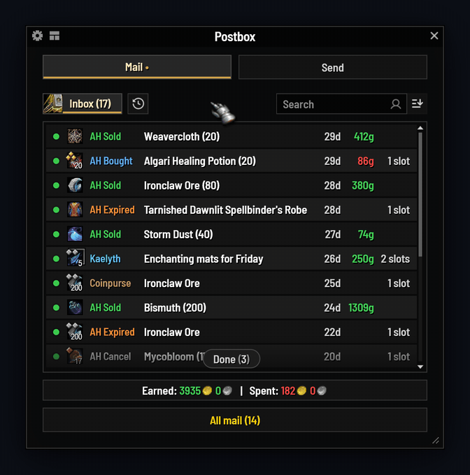
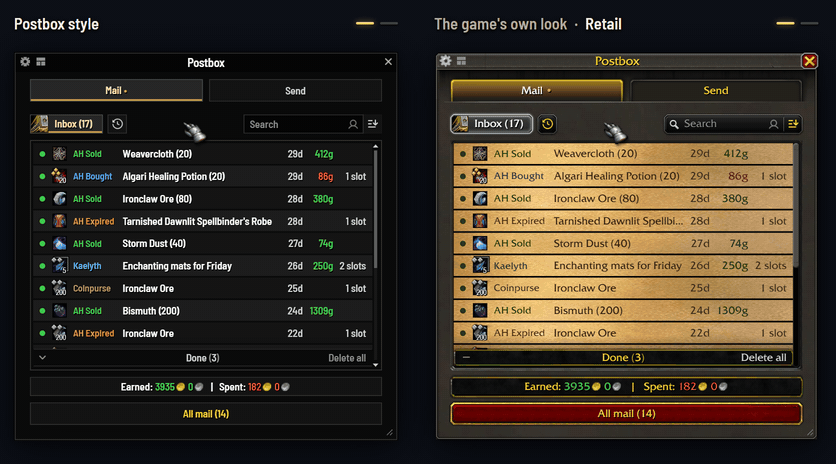
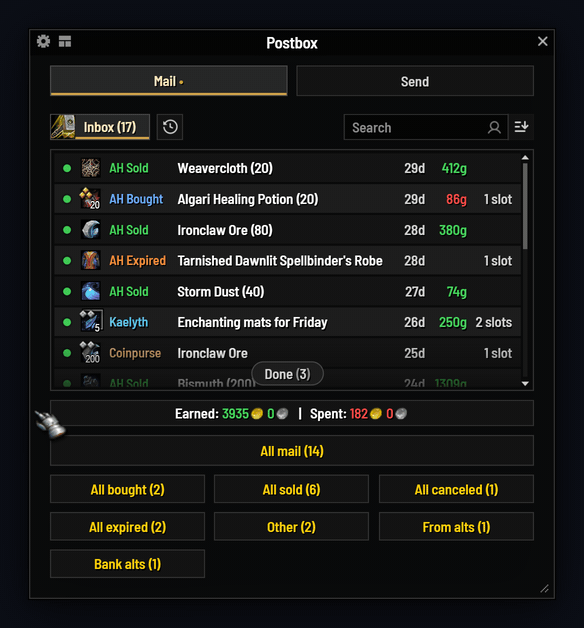
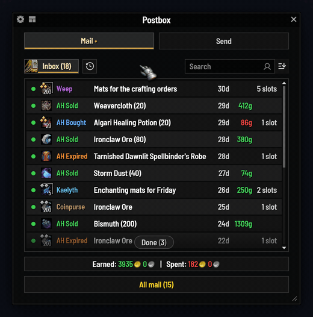
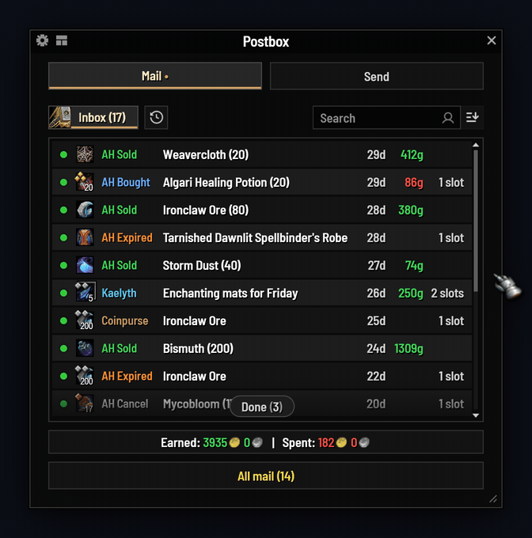
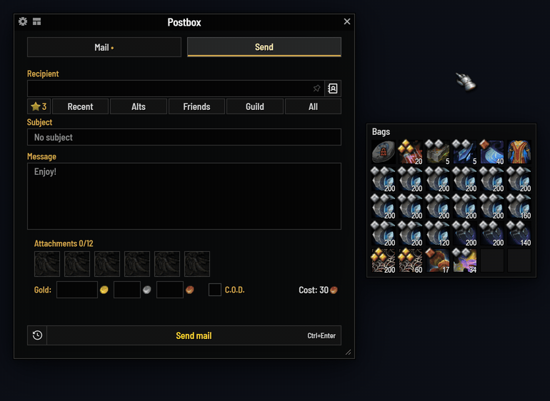
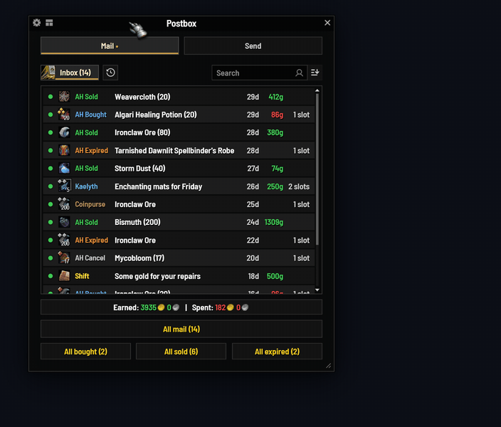
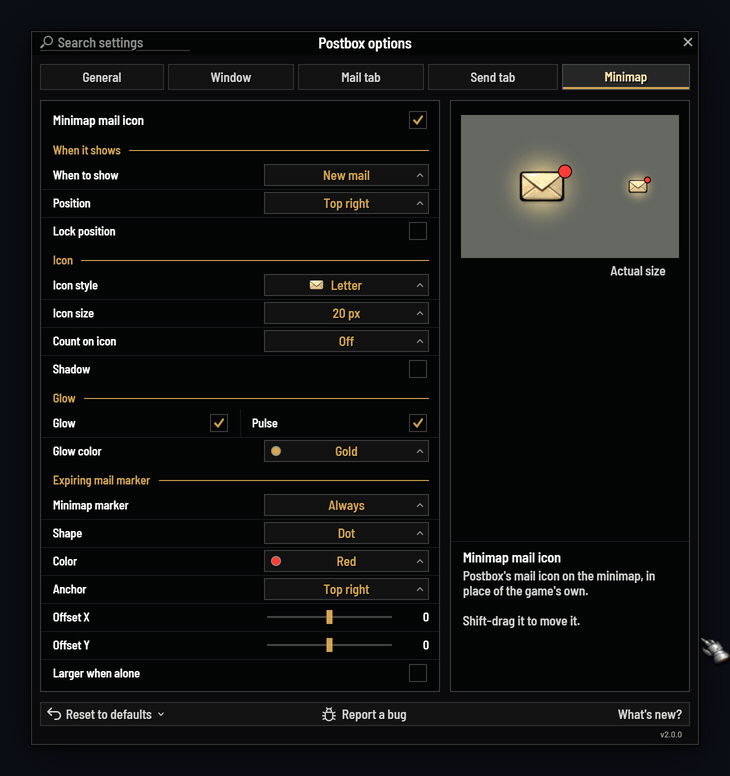
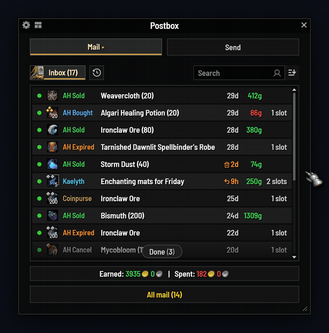

<h1 style="text-align:center">The mailbox Azeroth deserves.</h1>

<strong>Postbox replaces the game's mailbox with one fast window: collect in one click, send faster, and never lose mail on a forgotten alt.</strong> It works the moment you open a mailbox. Every extra has an off switch, and it stays light either way.

<strong>Retail · WoW Forever</strong> &nbsp;|&nbsp; <strong>Blizzard UI · ElvUI · EllesmereUI</strong> One download runs on retail and on World of Warcraft: Forever. On the Blizzard UI it wears the game's own look or its own Dark or Light style; under ElvUI or EllesmereUI it matches them.

<ul style="display:flex;flex-wrap:wrap;gap:20px 24px;padding-left:0">
<li style="display:block;flex:1;min-width:230px"><strong>All mail, one click</strong>: The whole inbox, gold, items and letters, in one go.</li>
<li style="display:block;flex:1;min-width:230px"><strong>Just what you want</strong>: Search an item's name, a sender or "sold", Shift- or Ctrl-click rows, or use buttons for sold, bought, your alts and your own Character Groups.</li>
<li style="display:block;flex:1;min-width:230px"><strong>Finished mail, out of the way</strong>: Read mail with nothing left waits under one quiet bar at the foot of the list, to fold away or clear in one go.</li>
<li style="display:block;flex:1;min-width:230px"><strong>Every alt's mail</strong>: What each character has waiting, and what each mail holds, searched from anywhere. At a mailbox, the Inbox button opens every character's box.</li>
<li style="display:block;flex:1;min-width:230px"><strong>Never lose expiring mail</strong>: The game deletes auction mail that runs out, gold and all. Postbox warns you at login and on the minimap while there's still time, and shows whether a mail about to run out goes back to its sender or is deleted.</li>
<li style="display:block;flex:1;min-width:230px"><strong>Faster sending</strong>: Names complete as you type, from the lists you choose. Right-click attaches; Alt-right-click attaches every stack.</li>
<li style="display:block;flex:1;min-width:230px"><strong>Your look, your layout</strong>: Matches EllesmereUI or ElvUI, wears the game's own look, letter paper and all, or its own Dark or Light style. Drag any column or button.</li>
<li style="display:block;flex:1;min-width:230px"><strong>A minimap icon</strong>: A count of what's waiting and an expiry marker, in two dozen styles.</li>
<li style="display:block;flex:1;min-width:230px"><strong>Safe with your gold</strong>: C.O.D. is never paid without asking, and full bags stop a run cleanly.</li>
</ul>

&nbsp;

<h2 style="text-align:center">Empty your mailbox in one click</h2>

All mail takes gold, items and letters in your list's order. Bags are checked first, a thin line under the title bar shows how far it has got (you can turn it off), and a run stops cleanly if they fill.

History keeps what you collected and what you sent, for up to a year, searchable by an item's name.

&nbsp;

<h2 style="text-align:center">A look for every UI</h2>

On the game's own UI, Postbox wears the game's own look by default, letter paper and all, on retail and WoW Forever, or the Postbox style in Dark or Light.

Under EllesmereUI or ElvUI it matches them: your font, your accent, live.

&nbsp;

<h2 style="text-align:center">Take only what you want</h2>

Ctrl- or Shift-click the mail you want, search "sold" or a name, or use one-click buttons for bought, sold, expired and your own Character Groups.

Sort by date, time left, gold or sender, show only unread mail, mail with gold or mail with items, and search finds a mail by the items inside it.

&nbsp;

<h2 style="text-align:center">One item, without opening the mail</h2>

Point at a mail's icon and its items fan out; a click takes the one you want (Attachments on hover: Fan out).

&nbsp;

<h2 style="text-align:center">Finished mail, out of the way</h2>

Read mail with nothing left waits under one quiet bar at the foot of the list. Fold it away, or clear it with Delete all, which asks first.

&nbsp;

<h2 style="text-align:center">Sending made easy</h2>

Names complete as you type, favorites first. Right-click attaches; Alt-right-click attaches every stack, and the + after Attachments every stack of one kind, or of everything under a heading.

Manage Recipients lists every name in one table: favorite, hide or add a note to any of them.

&nbsp;

<h2 style="text-align:center">Every alt's mail, at a glance</h2>

The minimap icon's tooltip lists every character with mail waiting. Mail Memory remembers each character's box at your last visit, to search from anywhere.

Mail you send your other characters shows in their box before they log in, and auctions you win, sell or cancel are counted as they happen.

&nbsp;

<h2 style="text-align:center">Arrange it your way</h2>

Drag any column or button, hide what you don't need, and choose what each figure shows.

&nbsp;

<h2 style="text-align:center">A minimap icon that tells you more</h2>

A count of what's waiting and a marker when mail is about to expire, in two dozen styles. With no mail it waits small and gray, and grows when mail comes. Off until you turn it on.

New mail can flash it and play a sound you choose, and a sold auction can play a sound of its own.

&nbsp;

<h2 style="text-align:center">Know where expiring mail goes</h2>

An arrow or a bin before the time left says whether a mail goes back to its sender or is deleted, while there's still time.

&nbsp;

<h2 style="text-align:center">And more</h2>
<ul>
<li><strong>The last 7 days:</strong> gold earned and spent by mail, for all your characters or the one you're on (Options &gt; General).</li>
<li><strong>A search in the options</strong> that finds any setting and takes you to it.</li>
<li><strong>A sold auction</strong> wears the icon of the item that sold.</li>
<li><strong>All mail takes:</strong> tick the kinds of mail All mail takes (auction house, the game, your characters, other players); what you untick stays in your mailbox for you to take yourself (Options &gt; Mail tab &gt; Collecting).</li>
</ul>

&nbsp;

<h2 style="text-align:center">Ready for WoW Forever</h2>

The same download runs in World of Warcraft: Forever. CurseForge lists it under WoW Forever, WowUp offers it for a Forever install, and Forever keeps settings of its own.

<ul style="display:flex;flex-wrap:wrap;gap:16px 24px;padding-left:0">
<li style="display:block;flex:1;min-width:230px"><strong>Full names:</strong> write "Abla Stone" or "Abla-Stone". Postbox uses the full name everywhere, so two of your characters with the same first name never get mixed up. Mail rows can show first or last names alone (Arrange &gt; Sender column).</li>
<li style="display:block;flex:1;min-width:230px"><strong>Forever's mail rules:</strong> your characters filed by ruleset, a warning before mail to another ruleset or to a first name alone, and no Warband bank.</li>
<li style="display:block;flex:1;min-width:230px"><strong>Your answer, always:</strong> gold from a stranger waits while you answer the game's question, and a slow send is waited for, never called failed.</li>
</ul>

Reload now works after a style change, EllesmereUI's WoW Forever look is matched, and with a controller (the Gamepad interface style) you get Blizzard's own mailbox. Built for Forever 1.60.1, so a Forever patch can show Postbox as out of date until it is updated.

&nbsp;

<ul style="display:flex;flex-wrap:wrap;gap:20px 24px;padding-left:0">
<li style="display:block;flex:1;min-width:230px"><strong>Safe by design</strong>: C.O.D. mail is never paid without asking, and one confirmation pays once, for the mail you chose. Deleting in bulk only ever removes finished mail you chose.</li>
<li style="display:block;flex:1;min-width:230px"><strong>Light on your game</strong>: No libraries, and no repeating timers away from a mailbox. A full refresh of 50 mails leaves under 2 KB of garbage. Blizzard's mail code is never replaced.</li>
<li style="display:block;flex:1;min-width:230px"><strong>Works with</strong>: EllesmereUI, ElvUI, Baganator, EllesmereUI bags and the default bags (unmailable items grayed while you send), and the default UI.</li>
</ul>

&nbsp;

<strong>Found a bug?</strong> Please report it, on <a href="https://github.com/egsherlock/Postbox/issues">GitHub</a> or in the comments here. Report a bug, at the foot of the options (or <code>/postbox debug</code>), gives you a report to paste in. Thank you!

Retail and WoW Forever, one download · settings are account-wide · type <code>/pb</code> for the options English, Français, Deutsch, Español, Русский, 简体中文, 繁體中文

Free and open source, and ideas are welcome: <a href="https://github.com/egsherlock/Postbox">github.com/egsherlock/Postbox</a> Glyphs class icons by Lorc and Delapouite, <a href="https://game-icons.net">game-icons.net</a>, CC BY 3.0.

